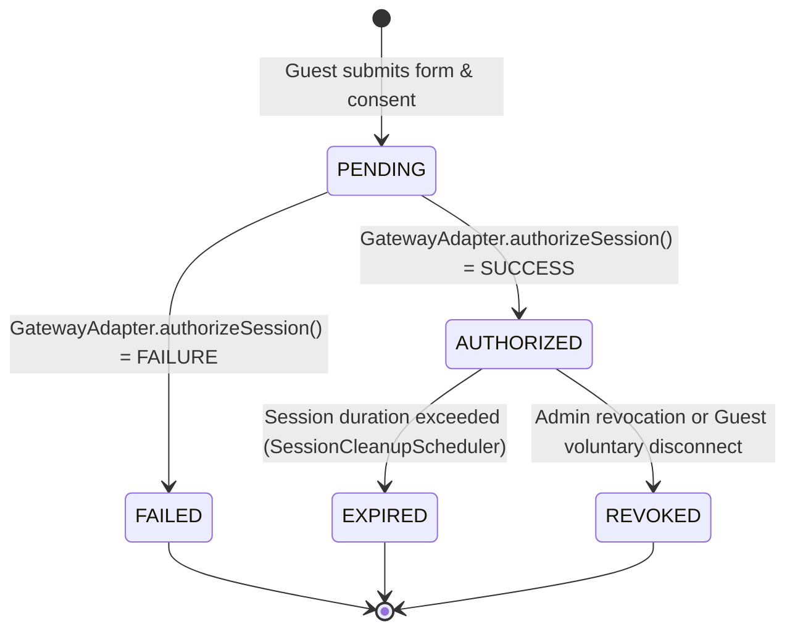

# 🌐 Wi-Fi Captive Portal — Backend Service

[](https://www.oracle.com/java/)
[](https://spring.io/projects/spring-boot)
[](https://spring.io/projects/spring-security)
[](https://www.postgresql.org/)
[](https://flywaydb.org/)
[](https://junit.org/junit5/)

Enterprise-grade **Modular Monolith** backend powering a commercial Wi-Fi Captive Portal and Administration Management System. Inspired by real-world retail and high-traffic public Wi-Fi infrastructure (such as Circle K convenience hubs, transit stations, and airport terminals).

---

## 📑 Table of Contents

- [Architectural Overview](#-architectural-overview)
- [Module Organization](#-module-organization)
- [Session Lifecycle & State Machine](#-session-lifecycle--state-machine)
- [Gateway Integration Boundary](#-gateway-integration-boundary)
- [Technology Stack](#-technology-stack)
- [REST API Reference](#-rest-api-reference)
- [Database Schema & Migrations](#-database-schema--migrations)
- [Getting Started](#-getting-started)
  - [Prerequisites](#prerequisites)
  - [Environment Variables](#environment-variables)
  - [Running with PostgreSQL (Docker Compose)](#running-with-postgresql-docker-compose)
  - [Running in Standalone Zero-Setup Mode (H2)](#running-in-standalone-zero-setup-mode-h2)
- [Automated Testing & Verification](#-automated-testing--verification)
- [Security & Compliance](#-security--compliance)

---

## 🏛 Architectural Overview

The backend is built as an extensible **Modular Monolith** with clean domain segregation. Business logic is strictly isolated from hardware-level firewall enforcement via the `GatewayAdapter` boundary interface.

```
                              ┌────────────────────────────────────────┐
                              │            Clients / Guests            │
                              │       (Mobile / Laptop Browsers)       │
                              └───────────────────┬────────────────────┘
                                                  │
                                                  ▼
                                      [Captive Portal REST API]
                                                  │
┌─────────────────────────────────────────────────┼───────────────────────────────────────────────┐
│ Wi-Fi Captive Portal Backend Core               │                                               │
│                                                 ▼                                               │
│  ┌─────────────────────────┐       ┌─────────────────────────┐       ┌──────────────────────┐  │
│  │     portal Module       │ ────> │     sessions Module     │ <───> │    devices Module    │  │
│  │ (Consent & Validation)  │       │ (State Machine & TTL)   │       │(MAC/IP Fingerprint)  │  │
│  └─────────────────────────┘       └────────────┬────────────┘       └──────────────────────┘  │
│                                                 │                                               │
│  ┌─────────────────────────┐                    ▼                    ┌──────────────────────┐  │
│  │   locations Module      │       ┌─────────────────────────┐       │     audit Module     │  │
│  │(Duration, Cap, Branding)│       │     gateway Module      │ ────> │ (Immutable Audit Log)│  │
│  └─────────────────────────┘       │    (GatewayAdapter)     │       └──────────────────────┘  │
│                                    └────────────┬────────────┘                                  │
│  ┌─────────────────────────┐                    │                    ┌──────────────────────┐  │
│  │ authentication Module   │                    │                    │   analytics Module   │  │
│  │   (Admin RBAC & JWT)    │                    │                    │(KPIs & Distribution) │  │
│  └─────────────────────────┘                    │                    └──────────────────────┘  │
└─────────────────────────────────────────────────┼───────────────────────────────────────────────┘
                                                  │
                    ┌─────────────────────────────┴─────────────────────────────┐
                    ▼                                                           ▼
      ┌───────────────────────────┐                               ┌───────────────────────────┐
      │    MockGatewayAdapter     │                               │      OPNsenseAdapter      │
      │ (Local MVP / Simulation)  │                               │ (VirtualBox / Production) │
      └───────────────────────────┘                               └───────────────────────────┘
```

---

## 📦 Module Organization

The project follows domain-driven packaging under `com.wificaptive`:

| Module | Package | Description |
|---|---|---|
| **`portal`** | `com.wificaptive.portal` | Public captive portal initialization, legal consent validation, guest login orchestration, and session status check. |
| **`sessions`** | `com.wificaptive.sessions` | Guest session entity, session state machine, manual revocation, and automated TTL expiration scheduler (`SessionCleanupScheduler`). |
| **`locations`** | `com.wificaptive.locations` | Multi-branch Wi-Fi location CRUD, session durations, bandwidth caps, promotional banners, and custom terms. |
| **`devices`** | `com.wificaptive.devices` | Client device tracking, hardware MAC normalization, IP binding, User-Agent OS detection (iOS, Android, macOS, Windows), and administrative blocklisting. |
| **`gateway`** | `com.wificaptive.gateway` | Boundary abstraction (`GatewayAdapter`), transaction logger, and `MockGatewayAdapter` with fault/latency injection. |
| **`analytics`** | `com.wificaptive.analytics` | High-level executive KPIs (Active Sessions, Today's Logins, Location Breakdown, Rolling 24h Timelines). |
| **`audit`** | `com.wificaptive.audit` | Non-repudiation audit trail logging admin logins, revocations, location edits, and gateway configuration changes. |
| **`authentication`** | `com.wificaptive.authentication` | BCrypt password hashing, Spring Security stateless JWT management, and self-bootstrapping development administrator. |
| **`common`** | `com.wificaptive.common` | Base entities with UTC timestamps, unified `ApiResponse<T>`, `ErrorResponse`, and `@RestControllerAdvice` global exception handling. |

---

## 🔄 Session Lifecycle & State Machine

Every guest session transitions through well-defined lifecycle states:



- **`PENDING`**: Initial record created upon valid consent verification.
- **`AUTHORIZED`**: Network pass rule accepted by the gateway; `expires_at` computed based on location TTL.
- **`REVOKED`**: Session terminated before expiration (either by an administrator with a logged reason or by the guest via the status page).
- **`EXPIRED`**: Passive TTL timeout processed automatically every 60 seconds by `SessionCleanupScheduler`.
- **`FAILED`**: Gateway reported failure or firewall rule insertion was rejected.

---

## 🔌 Gateway Integration Boundary

The business layer communicates with the network router exclusively through the Java contract:

```java
public interface GatewayAdapter {
    GatewayAuthResult authorizeSession(Long sessionId, String macAddress, String ipAddress, Integer durationMinutes, Integer maxBandwidthMbps);
    GatewayRevokeResult revokeSession(Long sessionId, String macAddress, String ipAddress, String gatewayReference);
    GatewayStatusDto getStatus();
    GatewayStatusDto updateConfig(MockGatewayConfigDto config);
}
```

### Mock Mode vs. Physical Hardware
- **`MockGatewayAdapter` (Shipped)**:
  - Tracks all operations into the `gateway_transactions` table.
  - Supports runtime **failure injection** (`simulateFailures=true`) to verify frontend error handling.
  - Supports configurable latency simulation (0 - 2000 ms).
  - Explicitly tags all responses with `isSimulated=true` to ensure transparency.
- **`OPNsenseAdapter` (Hardware Step)**:
  - Connects to the OPNsense Captive Portal REST API in VirtualBox to apply live `pf` packet filter table pass/drop rules.

---

## 🛠 Technology Stack

- **Runtime & Language**: Java 17 LTS
- **Framework**: Spring Boot 3.3.4
- **Security**: Spring Security 6 + JJWT 0.12.6
- **Persistence**: Spring Data JPA + Hibernate ORM 6.5
- **Database**: PostgreSQL 16 (Production/Docker) & H2 (In-memory testing & zero-setup mode)
- **Migrations**: Flyway Community Edition
- **Testing**: JUnit 5, Mockito, Spring Security Test, MockMvc
- **Build Tool**: Apache Maven 3.9+

---

## 📡 REST API Reference

### Public Portal APIs (Guest Flow)
| Method | Endpoint | Description |
|---|---|---|
| `GET` | `/api/portal/init?location={slug}` | Fetches location branding, terms, client IP hint, and gateway status. |
| `POST` | `/api/portal/login` | Validates consent, registers device, invokes gateway, creates session. |
| `GET` | `/api/portal/session/{token}` | Returns remaining seconds, status, and bandwidth profile. |
| `POST` | `/api/portal/session/{token}/disconnect` | Allows guest to voluntarily terminate their own session. |

### Admin APIs (Bearer JWT Required)
| Method | Endpoint | Description |
|---|---|---|
| `POST` | `/api/auth/login` | Authenticates administrator and returns Bearer JWT token. |
| `GET` | `/api/auth/me` | Retrieves the profile of the current authenticated administrator. |
| `GET` | `/api/admin/analytics/overview` | Returns system-wide KPIs, status distribution, and location shares. |
| `GET` | `/api/admin/analytics/trends` | Returns rolling timeline traffic histograms. |
| `GET` | `/api/admin/sessions` | Paginated guest sessions list with location, status, and search filters. |
| `GET` | `/api/admin/sessions/{id}` | Inspects detailed session parameters and gateway references. |
| `POST` | `/api/admin/sessions/{id}/revoke` | Revokes an active session with an audited reason. |
| `GET` | `/api/admin/locations` | Lists Wi-Fi locations with pagination and search. |
| `POST` | `/api/admin/locations` | Creates a new Wi-Fi deployment location. |
| `PUT` | `/api/admin/locations/{id}` | Updates location parameters (TTL, bandwidth, promo, terms). |
| `DELETE`| `/api/admin/locations/{id}` | Deletes a Wi-Fi location. |
| `GET` | `/api/admin/devices` | Lists registered client devices with OS detection. |
| `PATCH`| `/api/admin/devices/{id}/block?blocked=true` | Blocks/unblocks a hardware device MAC from authentication. |
| `GET` | `/api/admin/gateway/status` | Queries gateway health, adapter type, and operational telemetry. |
| `POST` | `/api/admin/gateway/config` | Updates mock failure simulation and latency parameters. |
| `GET` | `/api/admin/gateway/transactions` | Retrieves raw gateway transaction logs. |
| `GET` | `/api/admin/audit` | Retrieves immutable audit event logs. |

---

## 🗄 Database Schema & Migrations

Database versioning is managed via Flyway:

- **`V1__init_schema.sql`**: Creates tables: `admin_users`, `wifi_locations`, `devices`, `guest_sessions`, `gateway_transactions`, `audit_events`, along with performance B-Tree indexes.
- **`V2__seed_demo_data.sql`**: Seeds retail branches (`Circle K - Central Station`, `Circle K - Airport Gateway`, `Circle K - Riverside Promenade`), sample devices, and initial active sessions.
- **`V3__add_location_marketing_promo.sql`**: Adds marketing banners, customer survey prompts, and promotional links.

---

## 🚀 Getting Started

### Prerequisites
- **Java 17 JDK** (`java -version`)
- **Apache Maven 3.9+** (`mvn -version`)
- *(Optional)* **Docker & Docker Compose** (for local PostgreSQL)

### Environment Variables
Copy `.env.example` to `.env` or customize:
```bash
cp .env.example .env
```

Key variables:
```properties
SERVER_PORT=8080
SPRING_DATASOURCE_URL=jdbc:postgresql://localhost:5432/wifi_captive_db
POSTGRES_USER=postgres
POSTGRES_PASSWORD=postgres
JWT_SECRET=404E635266556A586E3272357538782F413F4428472B4B6250645367566B5970
JWT_EXPIRATION_HOURS=24
ADMIN_BOOTSTRAP_USERNAME=admin
ADMIN_BOOTSTRAP_PASSWORD=admin123
GATEWAY_ADAPTER_TYPE=mock
GATEWAY_SIMULATE_FAILURES=false
GATEWAY_SIMULATE_LATENCY_MS=100
```

### Running with PostgreSQL (Docker Compose)
1. Start the database:
   ```powershell
   docker compose up -d
   ```
2. Start the Spring Boot backend:
   ```powershell
   mvn spring-boot:run
   ```

### Running in Standalone Zero-Setup Mode (H2)
If Docker is not running, the application can boot instantly using the in-memory H2 profile (PostgreSQL dialect mode):
```powershell
mvn spring-boot:run -Dspring-boot.run.profiles=h2
```

The application starts on **`http://localhost:8080`**.
Initial admin bootstrap credentials:
- **Username**: `admin`
- **Password**: `admin123`

---

## 🧪 Automated Testing & Verification

Execute the complete test suite including integration tests against Flyway migrations:
```powershell
mvn clean test
```

### Verified Test Suites:
- ✅ **`CaptivePortalIntegrationTest`** (5 tests): Public init, mandatory consent rejection, full guest login flow, admin 403 protection, JWT login & access to protected endpoints.
- ✅ **`MockGatewayAdapterTest`** (4 tests): Reference generation, simulated failure handling (502), session revocation, status reporting.
- ✅ **`PortalServiceTest`** (3 tests): Consent check, end-to-end guest authentication transition (`PENDING` -> `AUTHORIZED`), gateway rejection transition (`PENDING` -> `FAILED`).
- ✅ **`GuestSessionServiceTest`** (3 tests): Session revocation, double revoke rejection, scheduled batch expiration of timed-out sessions.
- ✅ **`LocationServiceTest`** (3 tests): Location creation, duplicate slug conflict prevention, update logic.

---

## 🔒 Security & Compliance

1. **Stateless Authentication**: Admin endpoints require cryptographically signed Bearer JWT tokens.
2. **Untrusted Client Inputs**: Client-provided MAC/IP addresses are treated as unverified hints; values are validated and resolved server-side through trusted headers.
3. **No Credential Logging**: Passwords, tokens, and sensitive client details are strictly excluded from logging.
4. **Hardware Device Isolation**: Hardware MAC blocklisting rejects compromised or abusive clients immediately at the portal boundary.
5. **Auditing**: Every administrative and security action generates a non-repudiation audit record in `audit_events`.

---

## 📄 License

This project is licensed under the [MIT License](LICENSE).
