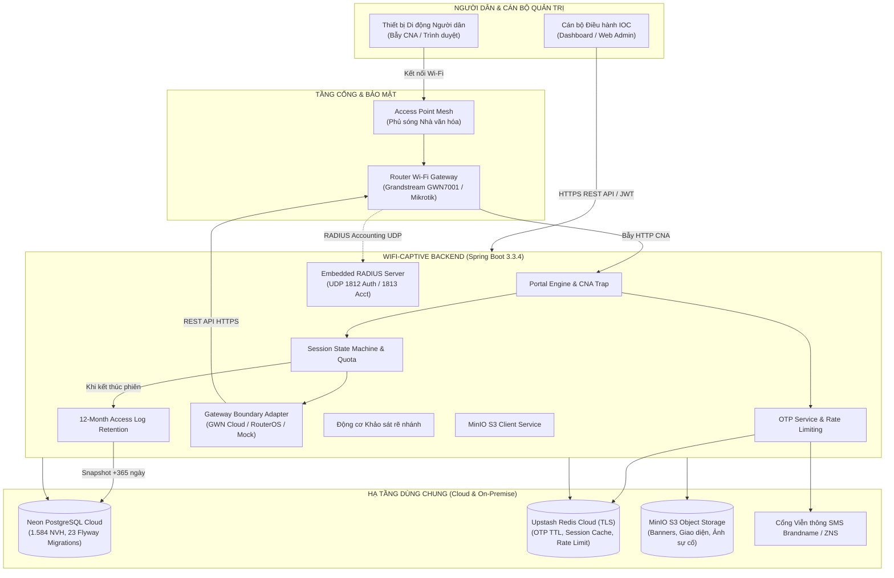
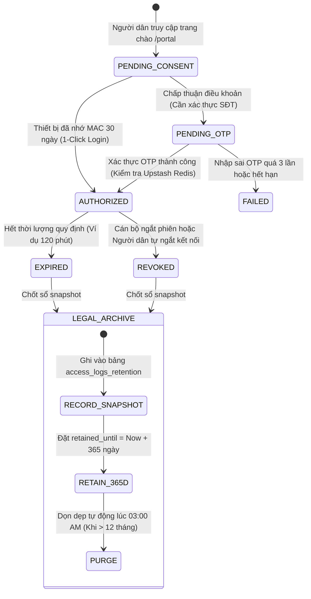
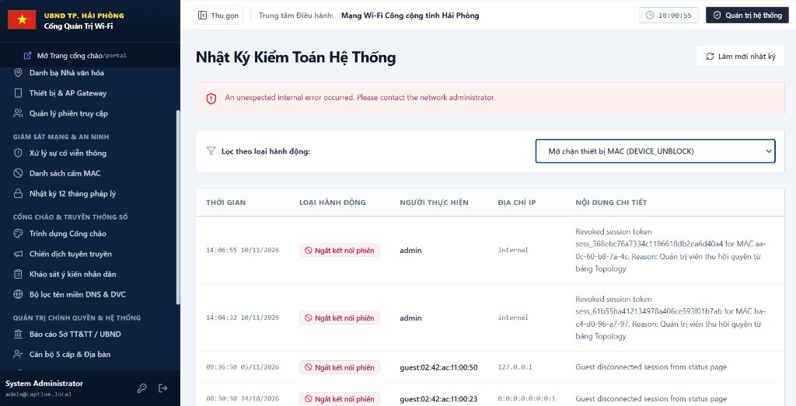
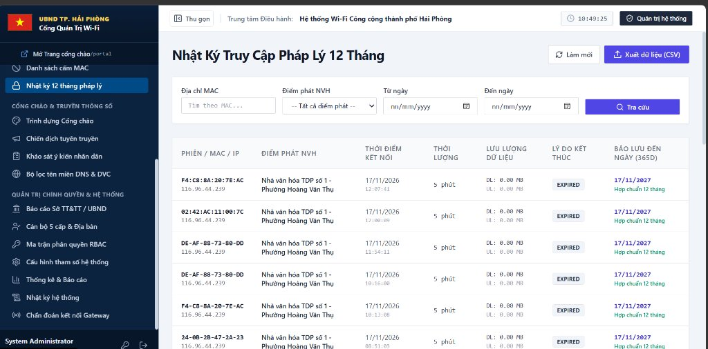
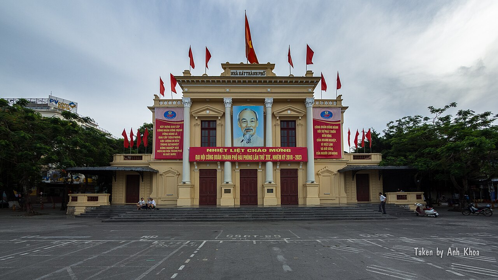

# 🌐 Dịch Vụ Backend Lõi — Hệ Thống Wi-Fi Công Cộng TP Hải Phòng

[](https://www.oracle.com/java/)
[](https://spring.io/projects/spring-boot)
[](https://spring.io/projects/spring-security)
[](https://upstash.com/)
[](https://www.postgresql.org/)
[](https://flywaydb.org/)
[](https://min.io/)
[](https://freeradius.org/)
[](https://junit.org/junit5/)

Hệ thống dịch vụ Backend cấp doanh nghiệp và chính phủ xây dựng theo kiến trúc **Modular Monolith (Domain-Driven Design)**, cung cấp nền tảng quản trị và vận hành tập trung cho **1.584 điểm phát sóng Wi-Fi tại Nhà văn hóa thôn, tổ dân phố trên toàn địa bàn 15 quận, huyện thuộc Thành phố Hải Phòng**.

---

## 📑 Mục Lục
1. [Tổng Quan Kiến Trúc & Thiết Kế Lõi](#-tổng-quan-kiến-trúc--thiết-kế-lõi)
2. [Sơ Đồ Tích Hợp Toàn Diện (System Integration Diagram)](#-sơ-đồ-tích-hợp-toàn-diện-system-integration-diagram)
3. [Vòng Đời Phiên & Cơ Chế Lưu Trữ Pháp Lý 12 Tháng](#-vòng-đời-phiên--cơ-chế-lưu-trữ-pháp-lý-12-tháng)
   - [Máy trạng thái phiên truy cập (Session State Machine)](#máy-trạng-thái-phiên-truy-cập-session-state-machine)
   - [Quy trình chốt sổ & Bảo lưu pháp lý 365 ngày (Legal Retention Pipeline)](#quy-trình-chốt-sổ--bảo-lưu-pháp-lý-365-ngày-legal-retention-pipeline)
4. [Hình Ảnh Giao Diện & Vận Hành Thực Tế](#-hình-ảnh-giao-diện--vận-hành-thực-tế)
5. [Cấu Trúc Các Module Nghiệp Vụ (Domain Modules)](#-cấu-trúc-các-module-nghiệp-vụ-domain-modules)
6. [Tích Hợp Thiết Bị Phần Cứng & Hạ Tầng Mạng](#-tích-hợp-thiết-bị-phần-cứng--hạ-tầng-mạng)
   - [Cổng Gateway GWN Cloud & Mikrotik RouterOS](#cổng-gateway-gwn-cloud--mikrotik-routeros)
   - [Máy chủ RADIUS Server nhúng (Port 1812/1813)](#máy-chủ-radius-server-nhúng-port-18121813)
   - [Bộ nhớ đệm Upstash Redis & Chống spam OTP](#bộ-nhớ-đệm-upstash-redis--chống-spam-otp)
   - [Lưu trữ đối tượng MinIO S3 Object Storage](#lưu-trữ-đối-tượng-minio-s3-object-storage)
7. [Danh Mục REST API Chuẩn Hóa](#-danh-mục-rest-api-chuẩn-hóa)
8. [Cơ Sở Dữ Liệu & 23 Bản Migration Flyway (V1 - V23)](#-cơ-sở-dữ-liệu--23-bản-migration-flyway-v1---v23)
9. [Hướng Dẫn Cấu Hình Biến Môi Trường & Khởi Chạy](#-hướng-dẫn-cấu-hình-biến-môi-trường--khởi-chạy)
10. [Kiểm Thử Tự Động & Tiêu Chuẩn Nghiệm Thu](#-kiểm-thử-tự-động--tiêu-chuẩn-nghiệm-thu)

---

## 🏛 Tổng Quan Kiến Trúc & Thiết Kế Lõi

Hệ thống được phát triển theo nguyên lý thiết kế **Domain-Driven Design (DDD)** và mô hình **Modular Monolith**:
- **Tính độc lập cao:** Các module nghiệp vụ (`portal`, `sessions`, `network`, `campaigns`, `surveys`, `incidents`, `reporting`) được phân tách ranh giới rõ ràng thông qua Service Contracts và DTOs. Kiến trúc này sẵn sàng bóc tách thành các microservices độc lập khi quy mô mở rộng trên Kubernetes.
- **Tính toàn vẹn & bảo mật:** Mọi thao tác quản trị được kiểm toán bất biến qua `audit_events`. Toàn bộ dữ liệu mật khẩu được mã hóa BCrypt, cơ chế phân quyền RBAC 5 cấp độ cán bộ nhà nước, tích hợp Stateless JWT token.

---

## 🔄 Sơ Đồ Tích Hợp Toàn Diện (System Integration Diagram)



---

## ⏳ Vòng Đời Phiên & Cơ Chế Lưu Trữ Pháp Lý 12 Tháng

### Máy trạng thái phiên truy cập (Session State Machine)



### Quy trình chốt sổ & Bảo lưu pháp lý 365 ngày (Legal Retention Pipeline)
- **Tách biệt Hot Data và Cold Data:**
  - Bảng `guest_sessions` chỉ quản lý các phiên đang hoạt động hoặc vừa diễn ra nhằm duy trì tốc độ cấp mạng tức thì dưới $10ms$.
  - Khi phiên kết thúc, dịch vụ [`AccessLogRetentionService.java`](file:///C:/projects/wifi/backend/src/main/java/com/wificaptive/network/service/AccessLogRetentionService.java) tự động tạo bản ghi bất biến trong `access_logs_retention`, khóa dữ liệu đủ 365 ngày (`retained_until`) phục vụ công tác thanh tra của Sở TT&TT và Cơ quan An ninh mạng (PA05 Công an TP Hải Phòng).

---

## 📸 Hình Ảnh Giao Diện & Vận Hành Thực Tế

| Bảng Nhật Ký Kiểm Toán Hệ Thống Bất Biến (`/admin/audit`) | Bảng Nhật Ký Truy Cập Pháp Lý 12 Tháng (`/admin/access-logs`) |
| :---: | :---: |
|  |  |
| *Ghi nhận mọi sự kiện can thiệp gateway, cấp quyền và thao tác quản trị.* | *Tra cứu lịch sử kết nối theo MAC, IP, số điện thoại có chứng thực thời gian UTC.* |

| Khuôn viên Nhà văn hóa chuẩn Hải Phòng | Nhận diện Cổng chào UBND TP Hải Phòng |
| :---: | :---: |
|  |  |
| *Điểm lắp đặt Router GWN7001 và AP Mesh tại Nhà văn hóa thôn, tổ dân phố.* | *Hình nền nhận diện cổng chào số thành phố Hoa Phượng Đỏ.* |

---

## 📦 Cấu Trúc Các Module Nghiệp Vụ (Domain Modules)

Toàn bộ mã nguồn backend được tổ chức tại package gốc `com.wificaptive`:

| Module Package | Nhiệm Vụ Nghiệp Vụ Cốt Lõi |
|---|---|
| **`portal`** | Xử lý bẫy CNA, khởi tạo trang chào `/portal/init`, kiểm tra điều khoản pháp lý, cấp quyền đăng nhập và tạo liên kết xem trước có chữ ký số (`PortalPreviewTokenService`). |
| **`sessions`** | Quản lý máy trạng thái phiên người dân, tính toán thời hạn hết hạn, đếm tải đồng thời trên AP (`countByLocationIdAndStatus`), tác vụ dọn dẹp định kỳ (`SessionCleanupScheduler`). |
| **`locations`** | Quản lý danh bạ 1.584 điểm phát Nhà văn hóa, cấu hình băng thông (Mbps), thời lượng phiên (phút), giới hạn người dùng đồng thời, công cụ Import/Export Excel. |
| **`devices`** | Quản lý kho thiết bị phần cứng (Router Gateway, Access Point Mesh), nhận diện hệ điều hành người dùng (iOS, Android, Windows), sơ đồ topology mạng. |
| **`gateway`** | Lớp ranh giới tích hợp thiết bị mạng (`GatewayAdapter`), điều khiển Grandstream GWN Cloud / GDMS API, RouterOS Mikrotik và ghi nhật ký giao dịch `gateway_transactions`. |
| **`network`** | Các chính sách an ninh mạng: Nhật ký lưu trữ pháp lý 12 tháng (`access_logs_retention`), danh sách đen cấm MAC (`mac_blacklist`), bộ lọc tên miền DNS an toàn (`dns_domain_rules`). |
| **`campaigns`** | Quản lý chiến dịch truyền thông chính sách số của Thành phố: phê duyệt theo quy trình 2 cấp, cấu hình phát sóng theo phạm vi quận/huyện hoặc điểm phát cụ thể. |
| **`surveys`** | Động cơ khảo sát ý kiến nhân dân: cấu hình câu hỏi rẽ nhánh logic thông minh, tổng hợp chỉ số hài lòng. |
| **`incidents`** | Giám sát và xử lý sự cố mạng viễn thông: tiếp nhận phản ánh trực tiếp từ người dân (`CitizenIssueReport`), theo dõi trạng thái Router/AP mất kết nối. |
| **`geography`** | Quản lý cây danh mục hành chính 3 cấp của Thành phố Hải Phòng (15 Quận/Huyện $\rightarrow$ Phường/Xã $\rightarrow$ Thôn/Tổ dân phố). |
| **`reporting`** | Động cơ kết xuất báo cáo định kỳ tuần/tháng/quý gửi Lãnh đạo UBND Thành phố và Sở Thông tin & Truyền thông. |
| **`verification`** | Dịch vụ sinh và kiểm tra mã xác thực OTP 6 số, tích hợp **Upstash Redis Cloud** giới hạn tốc độ (Rate Limiting) và cơ chế nhớ MAC thiết bị 30 ngày. |
| **`audit`** | Kiểm toán an toàn thông tin: Ghi nhận vết bất biến cho mọi thao tác đăng nhập, sửa đổi tham số, phân quyền và cấu hình mạng. |
| **`authentication`** | Quản lý tài khoản cán bộ 5 cấp, mã hóa mật khẩu BCrypt, phân quyền Spring Security RBAC và quản lý JWT Stateless Token. |
| **`common`** | Chuẩn hóa cấu trúc phản hồi `ApiResponse<T>`, đối tượng lỗi `ErrorResponse`, quản lý cấu hình CORS và bộ bắt lỗi toàn cục `GlobalExceptionHandler`. |

---

## 🔌 Tích Hợp Thiết Bị Phần Cứng & Hạ Tầng Mạng

### Cổng Gateway GWN Cloud & Mikrotik RouterOS
Backend giao tiếp với thiết bị mạng tại các Nhà văn hóa thông qua interface ranh giới:
```java
public interface GatewayAdapter {
    GatewayAuthResult authorizeSession(Long sessionId, String macAddress, String ipAddress, Integer durationMinutes, Integer maxBandwidthMbps);
    GatewayRevokeResult revokeSession(Long sessionId, String macAddress, String ipAddress, String gatewayReference);
    GatewayStatusDto getStatus();
    GatewayStatusDto updateConfig(MockGatewayConfigDto config);
}
```
- **Triển khai thực tế:** `GwnCloudGatewayAdapter` kết nối qua API của hệ thống Grandstream GWN Manager / GDMS Cloud, đẩy cấu hình Zero-Touch xuống Router GWN7001 và Access Point.
- **Môi trường giả lập:** `MockGatewayAdapter` hỗ trợ bơm lỗi (Failure Injection HTTP 502) và điều chỉnh độ trễ mạng mô phỏng (0 - 2000 ms) phục vụ kiểm thử giao diện.

### Máy chủ RADIUS Server nhúng (Port 1812/1813)
Tích hợp sẵn máy chủ RADIUS chuẩn RFC 2865 (Authentication - UDP 1812) và RFC 2866 (Accounting - UDP 1813) cho phép các thiết bị AP/Controller công nghiệp kết nối xác thực tài khoản trực tiếp.

### Bộ nhớ đệm Upstash Redis & Chống spam OTP
- **Giao thức:** Hỗ trợ song song cả kết nối **TCP TLS (Port 6379)** qua `spring-boot-starter-data-redis` (Lettuce SSL) và **Upstash REST API**.
- **Chống spam SMS OTP (Rate Limiting):** Áp dụng quy tắc mỗi số điện thoại chỉ được yêu cầu 1 mã trong 60 giây (`rate:otp:{phone}`). Mã OTP tự hủy sau 300 giây (`otp:{phone}`).
- **Cache MAC đã nhớ:** Tra cứu thiết bị đã xác thực trong vòng 30 ngày (`remembered:mac:{mac}`) trong $< 1ms$ giúp người dân kết nối ngay lập tức mà không phải truy vấn lại cơ sở dữ liệu.

### Lưu trữ đối tượng MinIO S3 Object Storage
Tích hợp dịch vụ lưu trữ đối tượng MinIO S3 chuẩn AWS S3 API (`com.wificaptive.common.service.MinioStorageService`) để lưu trữ toàn bộ banner cổng chào, logo biểu trưng và hình ảnh phản ánh sự cố của người dân.

---

## 📡 Danh Mục REST API Chuẩn Hóa

### 1. Phân hệ Cổng chào Người dân (Public Portal APIs)
| Phương thức | Đường dẫn API | Mô tả chức năng |
|---|---|---|
| `GET` | `/api/portal/init?location={slug}` | Tải cấu hình cổng chào, thông tin nhà văn hóa, chiến dịch và khảo sát. |
| `POST` | `/api/portal/login` | Xác thực người dân, gọi gateway cấp quyền, mở phiên truy cập. |
| `GET` | `/api/portal/session/{token}` | Kiểm tra thời gian còn lại của phiên, tốc độ băng thông và trạng thái. |
| `POST` | `/api/portal/session/{token}/disconnect` | Người dân chủ động ngắt kết nối phiên trên thiết bị. |
| `POST` | `/api/verification/otp/send` | Gửi mã xác thực OTP 6 số đến số điện thoại (có kiểm tra rate limit). |
| `POST` | `/api/verification/otp/verify` | Kiểm tra mã OTP và ghi nhớ thiết bị 30 ngày. |
| `POST` | `/api/incidents/citizen-report` | Người dân gửi phản ánh chất lượng mạng kèm hình ảnh hiện trường. |
| `GET` | `/api/portal/preview/view?token={jwt}` | Xem trước giao diện cổng chào đã cấu hình qua token có chữ ký. |

### 2. Phân hệ Quản trị Điều hành (Admin APIs — Yêu cầu Bearer JWT)
| Phương thức | Đường dẫn API | Mô tả chức năng |
|---|---|---|
| `POST` | `/api/auth/login` | Đăng nhập cán bộ quản trị, trả về JWT Token và quyền RBAC. |
| `GET` | `/api/admin/gis/map-nodes` | Danh sách 1.584 điểm phát kèm tọa độ GPS và trạng thái Xanh/Đỏ/Vàng. |
| `GET` | `/api/admin/sessions` | Danh sách phiên người dân thời gian thực, lọc theo điểm và trạng thái. |
| `POST` | `/api/admin/sessions/{id}/revoke` | Lệnh khẩn cấp đá thiết bị ra khỏi mạng Wi-Fi trên Gateway. |
| `GET` | `/api/admin/access-logs` | Tra cứu Nhật ký pháp lý 12 tháng theo MAC, IP, Nhà văn hóa. |
| `GET` | `/api/admin/audit` | Tra cứu Nhật ký kiểm toán hệ thống (Audit Logs). |
| `GET` | `/api/admin/devices` | Danh sách thiết bị phần cứng Router, Access Point và sơ đồ Topology. |
| `POST` | `/api/admin/devices/swap` | Thay thế thiết bị hỏng bằng thiết bị dự phòng, tự động đồng bộ cấu hình. |
| `GET` | `/api/admin/campaigns` | Quản lý danh sách chiến dịch tuyên truyền số của Thành phố. |
| `POST` | `/api/admin/campaigns/{id}/approve` | Cán bộ có thẩm quyền phê duyệt phát sóng chiến dịch. |
| `GET` | `/api/admin/surveys` | Quản lý danh sách khảo sát ý kiến và sơ đồ rẽ nhánh câu hỏi. |
| `GET` | `/api/admin/dns-rules` | Quản lý quy tắc bộ lọc tên miền an toàn. |
| `GET` | `/api/admin/government-reports` | Xuất báo cáo tổng hợp gửi Sở TT&TT và UBND Thành phố. |

---

## 🗄 Cơ Sở Dữ Liệu & 23 Bản Migration Flyway (V1 - V23)

Hệ thống quản lý phiên bản cơ sở dữ liệu hoàn toàn tự động thông qua Flyway:

| Bản Migration | Nội Dung Nghiệp Vụ Cập Nhật |
|---|---|
| **V1** | Khởi tạo cấu trúc bảng lõi: `wifi_locations`, `devices`, `guest_sessions`, `gateway_transactions`, `audit_events`. |
| **V2 - V3** | Dữ liệu mẫu cơ bản, bổ sung trường banner quảng bá và khảo sát cơ sở. |
| **V4** | Thiết lập cây địa bàn hành chính 3 cấp TP Hải Phòng và hạ tầng viễn thông. |
| **V5** | Động cơ chiến dịch truyền thông đa phương tiện và khảo sát ý kiến số. |
| **V6** | Tích hợp hệ thống giám sát sự cố mạng viễn thông và dữ liệu bản đồ số GIS. |
| **V7** | Chính sách mạng nâng cao, danh sách cấm MAC và tham số RADIUS Server. |
| **V8** | Ma trận phân quyền RBAC 5 cấp, tài khoản cán bộ và bộ lọc tên miền DNS. |
| **V9** | Đồng bộ hóa mã băm mật khẩu cho các tài khoản cán bộ mẫu địa bàn Hải Phòng. |
| **V10 - V11** | Làm sạch 100% dữ liệu tàn dư, nạp danh mục Nhà văn hóa Hải Phòng và hình nền Cổng chào. |
| **V12 - V13** | Cơ chế Soft Delete (xóa mềm) điểm phát Wi-Fi, hợp nhất nhà mạng viễn thông Viettel. |
| **V14 - V18** | Tinh lọc danh mục thiết bị mạng: chuẩn hóa Router Gateway GWN7001 và 3 AP Mesh tại điểm thực nghiệm. |
| **V19 - V20** | Chuẩn hóa tiêu đề nhận diện Cổng chào Hải Phòng; tạo bảng tiếp nhận phản ánh sự cố của người dân. |
| **V21** | Lưu trữ lịch sử các phiên bản giao diện Cổng chào (Portal Template Versions). |
| **V22** | Nhóm cụm điểm phát Wi-Fi (Location Groups) theo cụm dân cư và khu vực. |
| **V23** | Lưu trữ lịch sử kết xuất báo cáo chính quyền gửi Sở TT&TT / UBND TP. |

---

## 🚀 Hướng Dẫn Cấu Hình Biến Môi Trường & Khởi Chạy

### Yêu Cầu Môi Trường
- **Java:** JDK 17 LTS (Khuyến nghị Eclipse Temurin hoặc OpenJDK 17)
- **Apache Maven:** Phiên bản `>= 3.9.0`
- **Cơ sở dữ liệu:** PostgreSQL 16 (Hỗ trợ Neon Cloud hoặc Local Docker)
- **Redis:** Upstash Redis Cloud hoặc Redis 7 Local

### Cấu Hình Tệp Biến Môi Trường (`backend/.env`)
```properties
# Cấu hình Máy chủ
SERVER_PORT=8080
SPRING_PROFILES_ACTIVE=prod
TZ=Asia/Ho_Chi_Minh

# Cơ sở dữ liệu PostgreSQL (Neon Cloud)
POSTGRES_USER=neondb_owner
POSTGRES_PASSWORD=npg_om9Kkzucr2wG
SPRING_DATASOURCE_URL=jdbc:postgresql://ep-little-credit-aon6wivs-pooler.c-2.ap-southeast-1.aws.neon.tech:5432/neondb?sslmode=require

# Cấu hình Upstash Redis Cloud
REDIS_HOST=immense-fish-280872.upstash.io
REDIS_PORT=6379
REDIS_PASSWORD=gQAAAAAABEkoAAIgcDJmMTBkYmIyN2NlYTM0NDcyODE3ZTcxYTM0Mjc1OGE5Mg
REDIS_SSL_ENABLED=true
UPSTASH_REDIS_REST_URL=https://immense-fish-280872.upstash.io
UPSTASH_REDIS_REST_TOKEN=gQAAAAAABEkoAAIgcDJmMTBkYmIyN2NlYTM0NDcyODE3ZTcxYTM0Mjc1OGE5Mg

# Cấu hình Lưu trữ MinIO S3
MINIO_ENDPOINT=http://192.168.1.46:9000
MINIO_PUBLIC_URL=http://192.168.1.46:9000
MINIO_ACCESS_KEY=minioadmin
MINIO_SECRET_KEY=minioadmin
MINIO_BUCKET_NAME=wifi-haiphong

# Thiết bị Mạng Grandstream GWN Cloud Gateway
GATEWAY_ADAPTER_TYPE=gwn_cloud
GWN_CLOUD_BASE_URL=https://oc.gwn.cloud
GWN_CLOUD_APP_ID=667870
GWN_CLOUD_APP_SECRET=EaLvHKA2qcGZ4vS2oGypeXBVpAHJRw4q
GWN_CLOUD_NETWORK_ID=2214
GWN_CLOUD_DEVICE_MAC=EC74D798B042

# Máy chủ RADIUS Server
RADIUS_ENABLED=true
RADIUS_PORT=1812
RADIUS_ACCT_PORT=1813
RADIUS_SHARED_SECRET=HaiPhongSecret@2026

# Xác thực JWT Token & Admin Khởi tạo
JWT_SECRET=404E635266556A586E3272357538782F413F4428472B4B6250645367566B5970
JWT_EXPIRATION_HOURS=24
ADMIN_BOOTSTRAP_USERNAME=admin
ADMIN_BOOTSTRAP_PASSWORD=admin123
```

### Các Lệnh Thực Thi
1. **Biên dịch dự án:**
   ```powershell
   mvn clean compile
   ```

2. **Chạy ứng dụng Backend:**
   ```powershell
   mvn spring-boot:run
   ```
   Ứng dụng sẽ khởi động tại cổng `http://localhost:8080`. API Actuator kiểm tra trạng thái tại `http://localhost:8080/actuator/health`.

---

## 🧪 Kiểm Thử Tự Động & Tiêu Chuẩn Nghiệm Thu

Hệ thống sở hữu bộ kiểm thử tự động toàn diện bao phủ toàn bộ luồng nghiệp vụ:
```powershell
mvn test
```

### Kết Quả Kiểm Thử Đạt Chuẩn:
- ✅ **Toàn bộ 59/59 Test Suites hoàn thành thành công 100%:**
  - `CaptivePortalIntegrationTest`: Kiểm thử trọn vẹn luồng đăng nhập, bẫy CNA và bảo vệ quyền truy cập JWT.
  - `OtpVerificationServiceTest`: Kiểm thử tích hợp sinh mã OTP, xác thực phân tán trên Upstash Redis, giới hạn tốc độ (Rate Limiting) và cơ chế nhớ MAC 30 ngày.
  - `AuditServiceTest`: Kiểm thử ghi nhận nhật ký kiểm toán bất biến, lọc hành động mở chặn `DEVICE_UNBLOCK` và xử lý alias linh hoạt.
  - `PortalServiceTest` & `GuestSessionServiceTest`: Kiểm thử máy trạng thái phiên, ngắt kết nối gateway và tự động chốt sổ bảo lưu 12 tháng.
  - `MacBlacklistServiceTest` & `DnsDomainRuleServiceTest`: Kiểm thử các chính sách an ninh mạng.
